<h1 align="center">Pillbox</h1>

<p align="center">
  <b>A Material You bar, start menu and notification center for Hyprland, built with <a href="https://quickshell.org">Quickshell</a>.</b><br>
  Every widget is a rounded pill, every pill opens a panel, and everything re-colours itself from your wallpaper.
</p>

<p align="center">
  <a href="LICENSE"></a>
  
  
  
</p>


<p align="center">
  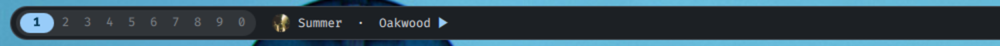
  
</p>

## Highlights

- **One shell, not five tools.** Bar, start menu, notification daemon, panels, wallpaper picker and keybind cheat sheet in one Quickshell config. No waybar, rofi, mako, dunst or swaync needed.
- **Start menu with real search.** Apps, every file and folder in your home, and optionally the *contents* of files and logs, in one fuzzy or regex search box. Pin apps, files and folders, and sort them into your own named groups.
- **Material You everywhere.** Pick a wallpaper and [matugen](https://github.com/InioX/matugen) re-themes the bar and every panel live.
- **Built for multi-monitor.** Every screen gets its own bar and its own workspaces (with the split-monitor-workspaces plugin). Developed daily on a six-monitor setup.
- **Any edge.** Top, bottom, left or right, with an optional mirrored pill order. Change it from a panel, no restart.
- **Keyboard and scripting friendly.** Every panel can be driven by `qs ipc call`, and the cheat sheet (SUPER + /) lists every Hyprland bind you gave a description.
- **Degrades gracefully.** Missing an optional tool? Only that feature hides, and the panel tells you what to install.

## Start menu

Click the Arch logo (or bind `qs ipc call start toggle`). Type to search apps, files and folders at once; press **Ctrl+F** to also search inside files and logs.

| | |
|:---:|:---:|
| 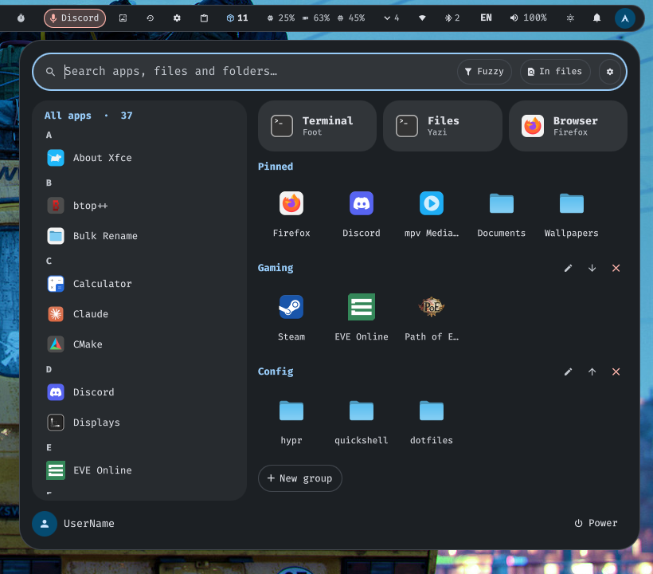 | 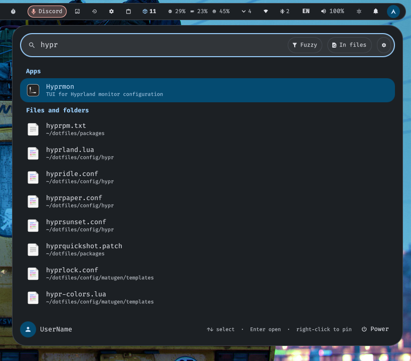 |
| **Home**: all apps A–Z, a hotbar for your terminal, file manager and browser, pins and your own groups | **Fuzzy search** across apps and every file and folder in your home (Ctrl+R for regex) |
| 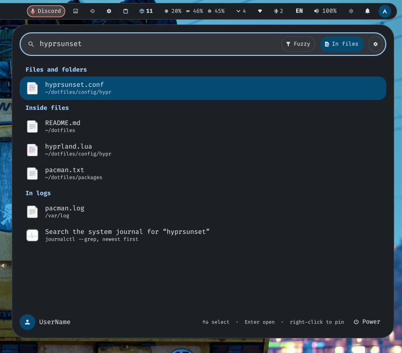 | 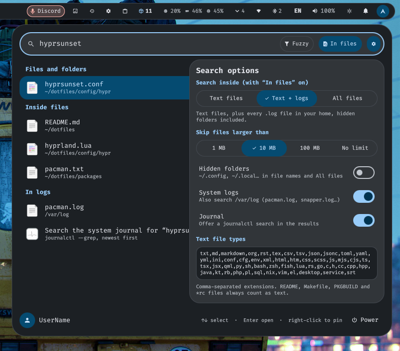 |
| **Inside files** (Ctrl+F): matching files, logs in your home and `/var/log`, and a one-click journal search | **Search options** (Ctrl+O): text only, text + logs or all files, a size limit, hidden folders, file types |

Right-click anything to pin it, add it to a group, reorder it or run one of the app's own actions (such as *New private window*). Groups can be renamed, reordered and deleted, and adding items to them never launches anything. Right-click the Arch logo for the power menu.

## Panels

| | |
|:---:|:---:|
| 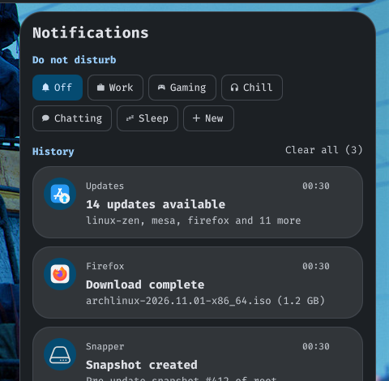 | 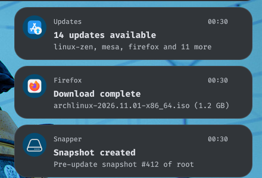 |
| **Notifications**: history plus Do-Not-Disturb profiles (Work, Gaming, Sleep, your own) | **Popups** on the monitor you're working on |
|  |  |
| **System stats**: CPU, GPU, RAM and disk with live graphs | **Sound**: outputs, inputs and per-app volume |
| 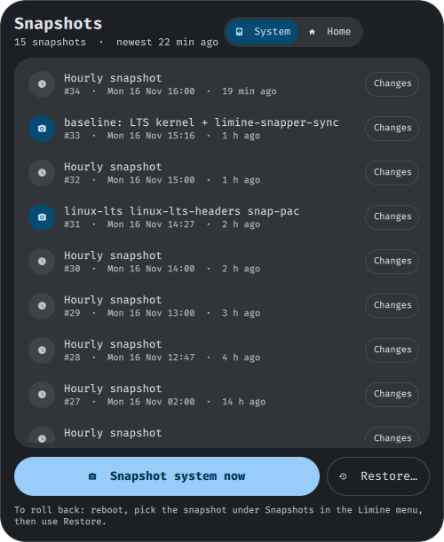 | 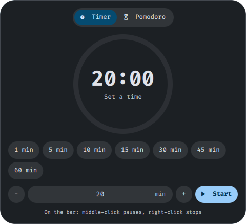 |
| **Snapshots**: snapper history, diff, snapshot now, restore | **Timer / Alarm / Pomodoro** with a progress ring |
| 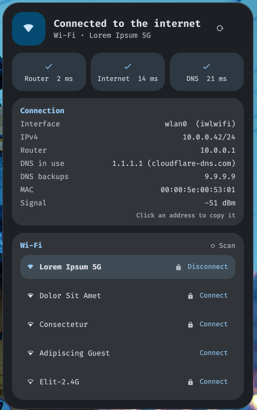 | 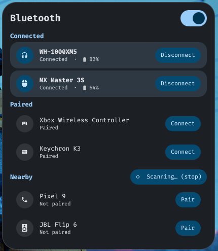 |
| **Network**: connection checks, addresses (click to copy) and Wi-Fi networks | **Bluetooth**: connected, paired and nearby devices, with battery levels |
| 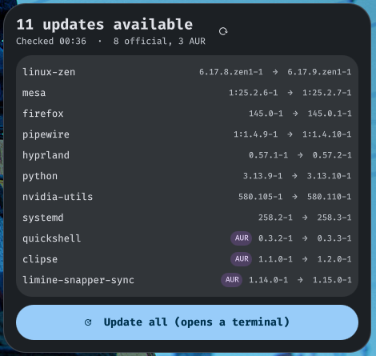 | 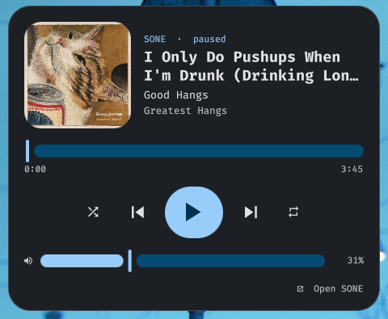 |
| **Updates**: repo and AUR updates, one click to update everything | **Media**: any MPRIS player, with seek and volume |

<sub>Network, Bluetooth, update and notification screenshots use sample data.</sub>


**Clock**: calendar, local time format and a second time zone


**Wallpaper picker**: click a wallpaper and the whole desktop re-themes from it

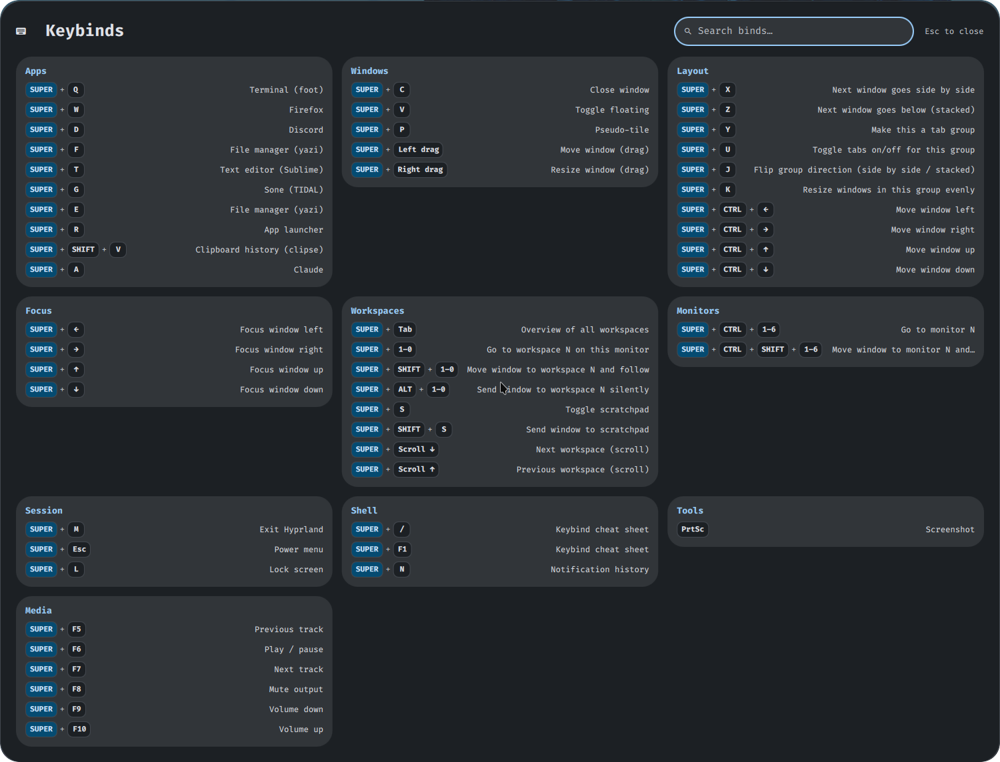
**Keybind cheat sheet** (SUPER + /), built from your Hyprland binds

### Any edge of the screen

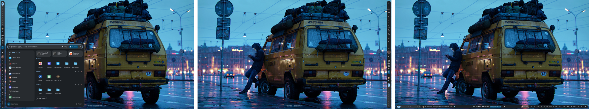
<p align="center"><sub>Left (start menu open) · Right, mirrored · Bottom. On the sides the bar narrows: titles hide and the clock stacks.</sub></p>

<p align="center">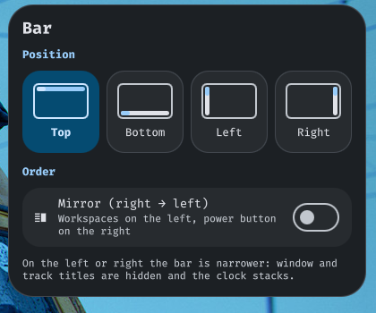<br><sub>Pick the edge and pill order from the gear pill, no restart needed.</sub></p>

## Features

| Pill | What it does |
|---|---|
| **Start menu** | The Arch logo. All apps A–Z with icons; one search box for apps and every file and folder in your home (fuzzy, or regex with Ctrl+R). Ctrl+F also searches inside files and logs (your home, `/var/log`, plus a journal search). Ctrl+O sets which files (text, text + logs, or all), a size limit, hidden folders and the text file types. Hotbar with your default terminal, file manager and browser; pinned apps, files and folders; your own named groups. Right-click the logo for the power menu (wlogout) |
| **Workspaces** | Each monitor's own workspaces with app icons; click or scroll to switch. Built for the [split-monitor-workspaces](https://github.com/zjeffer/split-monitor-workspaces) plugin (every monitor gets workspaces 1–10). Without the plugin it shows the workspaces on each monitor |
| **Clock** | Local time plus an optional second time zone. Click for a calendar and settings |
| **Timer / Alarm / Pomodoro** | Countdown, an alarm for a clock time ("at 11:00", with an optional heads-up and label), or Pomodoro cycles, with a progress ring. Middle-click pauses, right-click stops |
| **Media** | Now playing (MPRIS) with a player panel |
| **Notifications** | A full notification daemon: popups, history, and Do-Not-Disturb profiles |
| **Audio** | Volume with a mixer for each output, input and app. Scroll to change volume |
| **Network** | Interfaces, IP, DNS, connectivity checks, and Wi-Fi (iwd) |
| **Bluetooth** | Pair, connect and see battery levels |
| **System stats** | CPU, NVIDIA GPU and RAM in the bar. The panel adds graphs, temperatures and disks, plus btop and nvtop buttons |
| **Updates** | Pending repo and AUR updates; "Update all" runs paru, yay or pacman |
| **Failed services** | Appears only when a systemd unit failed. Offers Logs, Restart and Clear |
| **Snapshots** | Snapper snapshots (system and home): see changes, take one now, or restore (limine-snapper-sync) |
| **Wallpaper picker** | Thumbnail grid. Clicking one sets the wallpaper and re-themes everything |
| **Keyboard layout** | Shows EN / RU / … and switches layout on click |
| **Tray** | System tray; pin items to the bar |
| **Privacy** | Shows when the mic or camera is in use, and by which app |
| **Night light** | hyprsunset on/off, warmer/cooler |
| **Pause auto-lock** | Keeps the screen from idle-locking for 15 min to 8 h, or until you turn it back on (Wayland idle inhibitor, works with hypridle). Right-click pauses or resumes |
| **Lock keys** | Caps Lock / Num Lock indicators |
| **Keybind cheat sheet** | Every Hyprland bind that has a description, searchable |
| **Bar settings** | Put the bar on the top, bottom, left or right edge, and mirror the pill order |

## Install

Pillbox is developed on Arch Linux with Hyprland 0.57 and Quickshell 0.3.2, and works with either `hyprland.conf` or the newer `hyprland.lua` config. There are two ways to install it.

### Option 1: Arch package (recommended on Arch)

The repo includes a `PKGBUILD` for `pillbox-git`. It builds a normal pacman package from the latest commit, so pacman tracks every file and `pacman -R pillbox-git` removes it cleanly. (It isn't on the AUR yet, because AUR registration is currently closed.)

```bash
git clone https://github.com/tylort69/pillbox
cd pillbox/packaging/arch
makepkg -si
```

The package installs to `/etc/xdg/quickshell/pillbox`, so Quickshell runs it by name. Start it from Hyprland, and tell `qs ipc` which config your keybinds talk to:

```
# hyprland.conf
env = QS_CONFIG_NAME,pillbox
exec-once = qs -c pillbox

-- hyprland.lua
hl.env("QS_CONFIG_NAME", "pillbox")
hl.exec_cmd("qs -c pillbox")
```

For colours from your wallpaper, add this to `~/.config/matugen/config.toml`:

```toml
[templates.quickshell]
input_path = "/etc/xdg/quickshell/pillbox/matugen/quickshell-colors.json"
output_path = "~/.cache/quickshell-colors.json"
```

To update, rebuild the package with `makepkg -si` from the same folder. Restart the bar afterwards (`qs -c pillbox kill`, then start it again).

### Option 2: git clone (any distro)

On distros other than Arch, install the packages below with your package manager and run `./install.sh` without `--deps`.

```bash
git clone https://github.com/tylort69/pillbox ~/.local/share/pillbox
cd ~/.local/share/pillbox
./install.sh --deps
```

`install.sh` does three things:

1. Checks the dependencies and, with `--deps`, installs the missing ones. AUR packages go through paru or yay. `--check` only reports.
2. Links `~/.config/quickshell` to the clone. If you already have a config there, it is moved to a `.bak-<date>` folder first.
3. Adds the bar's colour template to `~/.config/matugen/config.toml`.

Then start it from Hyprland:

```
# hyprland.conf
exec-once = quickshell

-- hyprland.lua
hl.exec_cmd("quickshell")
```

To update, run `git pull`. Quickshell reloads the bar by itself.

Whichever way you install it, remove any other bar or notification daemon you were starting.

## Dependencies

Package names are for Arch Linux. Run `./install.sh --check` to see what you're missing.

### Required

| Package | Why |
|---|---|
| `quickshell` | Runs the bar |
| `hyprland` | Workspaces, keyboard layouts, cheat sheet and IPC all use Hyprland |
| `ttf-firacode-nerd` | Font and icons (any Nerd Font works; change `fontFamily` in `shell.qml`) |
| `python` | Helper scripts for stats, network, privacy and regex search |
| `pipewire`, `wireplumber` | Audio pill, mixer and privacy indicator |
| `libnotify` | `notify-send` for timer and error alerts |

### Optional, by feature

Without these the bar still runs; only the matching feature is missing (several panels tell you what to install).

| Feature | Packages |
|---|---|
| Start menu file search | `fd`, `fzf`; `ripgrep` for searching inside files |
| Separate workspaces 1–10 on every monitor | [split-monitor-workspaces](https://github.com/zjeffer/split-monitor-workspaces) Hyprland plugin (`hyprpm add https://github.com/zjeffer/split-monitor-workspaces`) |
| Colours from your wallpaper | `matugen` |
| Wallpaper picker | `imagemagick` (thumbnails; `ffmpeg` also works), plus `hyprpaper` or `swww` / `awww` / `swaybg` |
| Updates panel | `pacman-contrib` (checkupdates); `paru` or `yay` for AUR updates |
| Night light | `hyprsunset` (its schedule comes from `~/.config/hypr/hyprsunset.conf`) |
| Bluetooth | `bluez`, `bluez-utils`, with `bluetooth.service` enabled |
| Network panel | `systemd-networkd` + `systemd-resolved` (part of `systemd`) and `iwd` for Wi-Fi. NetworkManager isn't supported yet |
| Snapshots panel | `snapper` on btrfs, with `ALLOW_USERS` set so you can list snapshots. `limine-snapper-sync` (AUR) adds the Restore button |
| GPU stats | `nvidia-utils` (`nvidia-smi`). On other GPUs the GPU pill hides itself |
| Timer alarm sound | `sound-theme-freedesktop`, `pipewire-audio` (`pw-play`) |
| Restart / Clear in the services panel | A polkit agent, e.g. `hyprpolkitagent` |
| Launcher buttons | `btop`, `nvtop`, `wiremix`, `pavucontrol`, `wlogout`, `yazi`, `clipse` (AUR) + `wl-clipboard` |
| A terminal | Any of foot, kitty, alacritty, ghostty, wezterm, konsole, gnome-terminal or xterm. Detected automatically, or set `$TERMINAL` or `"terminal"` in `settings.json` |

## Configuration

Most things are set from the panels themselves. Under the hood:

- **`~/.config/pillbox/settings.json`** (created the first time you change something) stores clocks, DND profiles, Pomodoro lengths, pinned tray items, bar position (`barPosition`: `top`/`bottom`/`left`/`right`, `barMirror`), start menu pins, groups and search settings (`startPins`, `startGroups`, `startSearchMode`, `startSearchContents`, `startSearchOptions`), `terminal` and `wallpaperDir`. It lives outside the bar's own folder, so updates never touch it. Older versions kept it next to `shell.qml`; it's moved to the new place automatically.
- **Colours**: `matugen/quickshell-colors.json` is the matugen template, written to `~/.cache/quickshell-colors.json`. The bar picks up changes live. Without matugen it uses a built-in palette.
- **Wallpapers** are read from `~/Pictures/Wallpapers` (or `wallpaperDir`). Picking one runs `scripts/set-wallpaper.sh`, which sets the wallpaper with your daemon, points `~/.cache/current-wallpaper` at it (handy for hyprlock), then runs `~/.config/matugen/apply.sh` if you have one, or `matugen image` otherwise.
- **Size, font, margins**: properties at the top of `shell.qml` (`barHeight`, `fontFamily`, `cornerRadius`, …).
- **Keybind cheat sheet** shows every bind that has a description. In `hyprland.conf` use `bindd`; in `hyprland.lua` pass `{ description = "…" }`.
- **Start menu file index**: `fd` writes the list of your files to `~/.cache/pillbox/`, and opening the menu refreshes it in the background when it's more than 10 minutes old. Searching that list stays instant even with 100k+ files.

## IPC

Every panel can be driven from keybinds with `qs ipc call <target> <function>`. If you installed the package, set `QS_CONFIG_NAME=pillbox` as shown in Install, or use `qs -c pillbox ipc call …`.

| Target | Functions |
|---|---|
| `start` | `toggle`, `pin <desktop-id or /path> <group>` (empty group = Pinned) |
| `cheatsheet` | `toggle` |
| `notifs` | `toggle`, `clear`, `cycle` (DND profiles), `profile <name>`, `off` |
| `audio` | `toggle`, `up`, `down`, `mute` |
| `media` | `toggle`, `playpause`, `next`, `previous` |
| `timer` | `toggle`, `start <minutes>`, `alarm <time>` (e.g. `11:00`, `7:45pm`), `pomodoro`, `pause`, `stop` |
| `wallpaper` | `toggle`, `random` |
| `keyboard` | `next` |
| `bar` | `toggle` (settings panel), `position <top\|bottom\|left\|right>`, `mirror <true\|false>` |
| `night` | `toggle`, `warmer`, `cooler` |
| `autolock` | `toggle`, `pause <minutes>` (0 = until resumed), `resume`, `panel` |
| `updates`, `services` | `toggle`, `check` |
| `clock`, `stats`, `network`, `bluetooth`, `snapshots`, `tray` | `toggle` |

For example, in `hyprland.conf`:

```
bindd = SUPER, space, Start menu, exec, qs ipc call start toggle
bindd = SUPER, slash, Keybind cheat sheet, exec, qs ipc call cheatsheet toggle
bindd = SUPER, N, Notification history, exec, qs ipc call notifs toggle
bindd = SUPER SHIFT, W, Random wallpaper, exec, qs ipc call wallpaper random
bindel = , XF86AudioRaiseVolume, exec, qs ipc call audio up
```

## Troubleshooting

- **Something looks wrong**: run `qs log` (`qs -c pillbox log` for the package). Config errors show up there with a file and line number.
- **A pill is missing**: its optional package isn't installed. `./install.sh --check` lists what's missing.
- **Notifications don't show up in Pillbox**: another daemon (mako, dunst, swaync) got the notification service first. Stop it, remove it from your autostart, and restart Quickshell.
- **A panel opens on the wrong monitor**: panels opened through IPC follow Hyprland's focused monitor.

## Contributing

Issues and pull requests are welcome. Pillbox is tested on one (very wide) Arch + NVIDIA setup, so reports from other GPUs, distros and single-monitor setups are especially useful. Please include `qs log` output with bug reports.

## License

[MIT](LICENSE)
