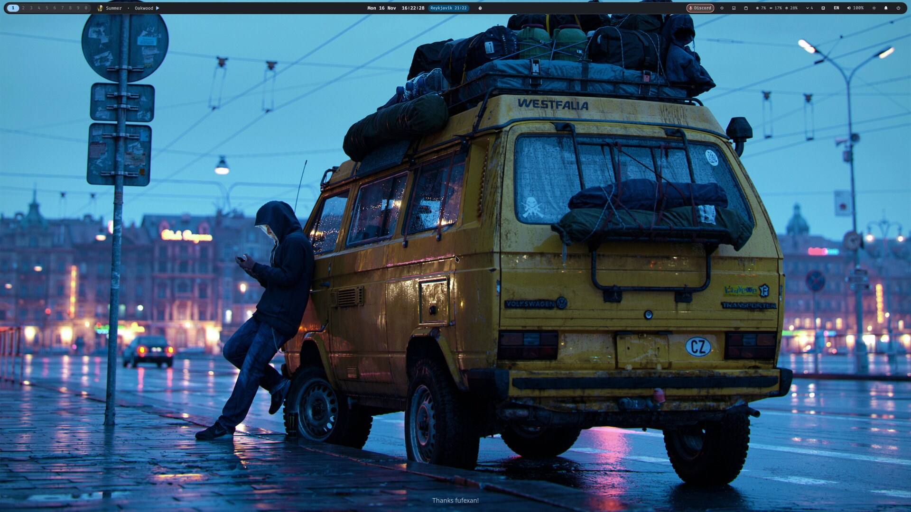
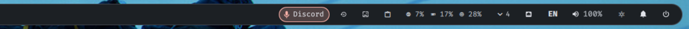
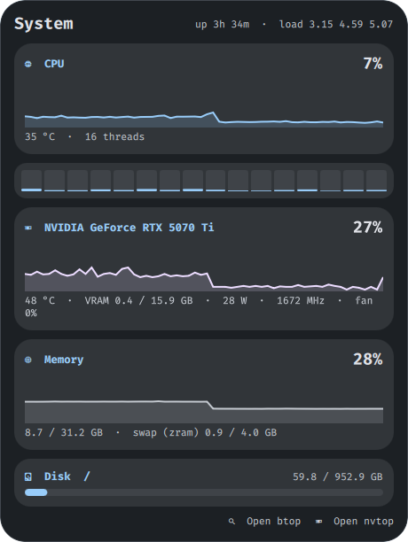
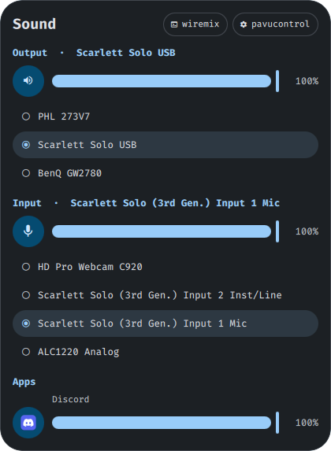
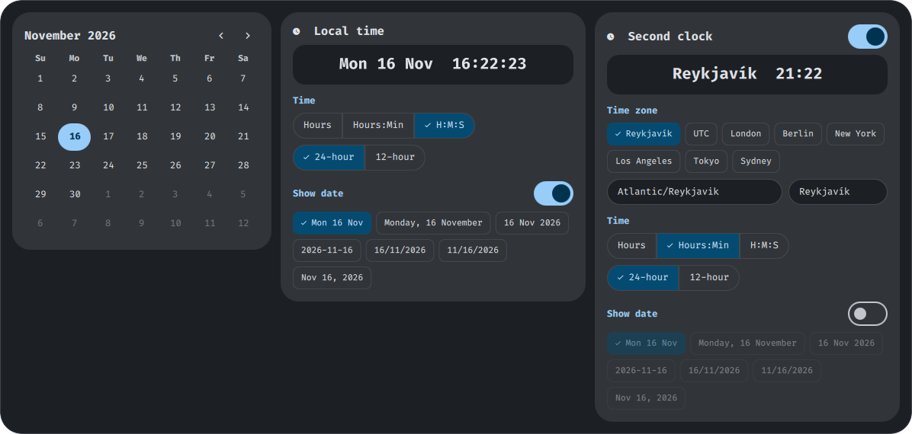
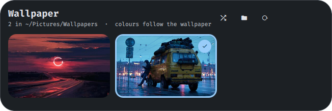

# Pillbox

A Material You bar for **Hyprland**, built with [Quickshell](https://quickshell.org).
Every widget is a rounded pill, every pill opens a panel, and the whole thing re-colours
itself from your wallpaper through [matugen](https://github.com/InioX/matugen).

It also replaces your notification daemon, so you don't need mako, dunst or swaync.

Built and tested on Arch Linux with Hyprland 0.57 and Quickshell 0.3.2, on a six-monitor setup with the
split-monitor-workspaces plugin, so every screen gets its own bar and its own workspaces. It works with either
`hyprland.conf` or the newer `hyprland.lua` config.



<p align="center">
  
  
</p>

## Screenshots

| | |
|:---:|:---:|
|  |  |
| **System stats**: CPU, GPU, RAM and disk with live graphs | **Sound**: outputs, inputs and per-app volume |
|  |  |
| **Snapshots**: snapper history, diff, snapshot now, restore | **Timer / Pomodoro** |


**Clock**: calendar, local time format and a second time zone


**Wallpaper picker**: click a wallpaper and the whole desktop re-themes from it


**Keybind cheat sheet** (SUPER + /), built from your Hyprland binds

## Features

| Pill | What it does |
|---|---|
| **Workspaces** | Each monitor's own workspaces with app icons; click or scroll to switch. Built for the [split-monitor-workspaces](https://github.com/zjeffer/split-monitor-workspaces) plugin, which gives every monitor its own set of workspaces numbered 1–10, and the pills match that. Without the plugin it shows the workspaces on each monitor |
| **Clock** | Local time plus an optional second time zone. Click for a calendar and settings |
| **Timer / Pomodoro** | Countdown or Pomodoro cycles with a progress ring and an alarm. Middle-click pauses, right-click stops |
| **Media** | Now playing (MPRIS) with a player panel |
| **Notifications** | Popups, history, and Do-Not-Disturb profiles (Work, Gaming, Sleep…) |
| **Audio** | Volume with a mixer panel for each output, input and app. Scroll to change volume |
| **Network** | Interfaces, IP, DNS, connectivity checks, and Wi-Fi (iwd) |
| **Bluetooth** | Pair, connect and see battery levels |
| **System stats** | CPU, NVIDIA GPU and RAM in the bar. The panel adds graphs, temperatures and disks, plus btop and nvtop buttons |
| **Updates** | Pending repo and AUR updates; "Update all" runs paru, yay or pacman |
| **Failed services** | Appears only when a systemd unit failed. Offers Logs, Restart and Clear |
| **Snapshots** | Snapper snapshots (system and home): see changes, take one now, or restore (limine-snapper-sync) |
| **Wallpaper picker** | Thumbnail grid. Clicking one sets the wallpaper and re-themes everything |
| **Keyboard layout** | Shows EN / RU / … and switches layout on click |
| **Tray** | System tray; pin items to the bar |
| **Privacy** | Shows when the mic or camera is in use, and by which app |
| **Night light** | hyprsunset on/off, warmer/cooler |
| **Lock keys** | Caps Lock / Num Lock indicators |
| **Keybind cheat sheet** | Every Hyprland bind that has a description, searchable |
| **Power** | Opens wlogout |
| **Bar settings** | Gear icon: put the bar on the top, bottom, left or right edge, and mirror the pill order. On the sides the bar is narrower: titles are hidden and the clock stacks |

## Install

```bash
git clone https://github.com/tylort69/pillbox ~/.local/share/pillbox
cd ~/.local/share/pillbox
./install.sh --deps
```

`install.sh` does three things:

1. Checks the dependencies and, with `--deps`, installs the missing ones. AUR packages go through paru or yay.
2. Links `~/.config/quickshell` to the clone. If you already have a config there, it is moved to a `.bak-<date>` folder first.
3. Adds the bar's colour template to `~/.config/matugen/config.toml`.

Then start it from Hyprland:

```
# hyprland.conf
exec-once = quickshell

-- hyprland.lua
hl.exec_cmd("quickshell")
```

To update, run `git pull`. Quickshell reloads the bar by itself.

## Dependencies

Package names are for Arch Linux. Run `./install.sh --check` to see what you're missing.

### Required

| Package | Why |
|---|---|
| `quickshell` | Runs the bar |
| `hyprland` | Workspaces, keyboard layouts, cheat sheet and IPC all use Hyprland |
| `ttf-firacode-nerd` | Font and icons (any Nerd Font works; change `fontFamily` in `shell.qml`) |
| `python` | Helper scripts for stats, network and privacy |
| `pipewire`, `wireplumber` | Audio pill, mixer and privacy indicator |
| `libnotify` | `notify-send` for timer and error alerts |

### Optional, by feature

Without these the bar still runs; only the matching feature is missing (several panels tell you what to install).

| Feature | Packages |
|---|---|
| Separate workspaces 1–10 on every monitor | [split-monitor-workspaces](https://github.com/zjeffer/split-monitor-workspaces) Hyprland plugin (install with `hyprpm add https://github.com/zjeffer/split-monitor-workspaces`) |
| Colours from your wallpaper | `matugen` |
| Wallpaper picker | `imagemagick` (thumbnails; `ffmpeg` also works), plus `hyprpaper` or `swww` / `awww` / `swaybg` |
| Updates panel | `pacman-contrib` (checkupdates); `paru` or `yay` for AUR updates |
| Night light | `hyprsunset` (its schedule comes from `~/.config/hypr/hyprsunset.conf`) |
| Bluetooth | `bluez`, `bluez-utils`, with `bluetooth.service` enabled |
| Network panel | `systemd-networkd` + `systemd-resolved` (part of `systemd`) and `iwd` for Wi-Fi. NetworkManager isn't supported yet |
| Snapshots panel | `snapper` on btrfs, with `ALLOW_USERS` set so you can list snapshots. `limine-snapper-sync` (AUR) adds the Restore button |
| GPU stats | `nvidia-utils` (`nvidia-smi`). On other GPUs the GPU pill hides itself |
| Timer alarm sound | `sound-theme-freedesktop`, `pipewire-audio` (`pw-play`) |
| Restart / Clear in the services panel | A polkit agent, e.g. `hyprpolkitagent` |
| Launcher buttons | `btop`, `nvtop`, `wiremix`, `pavucontrol`, `wlogout`, `yazi`, `clipse` (AUR) + `wl-clipboard` |
| A terminal | Any of foot, kitty, alacritty, ghostty, wezterm, konsole, gnome-terminal or xterm. Detected automatically, or set `$TERMINAL` or `"terminal"` in `settings.json` |

## Configuration

- **`settings.json`** (created next to `shell.qml` the first time you change something) stores clocks, DND profiles, Pomodoro lengths, pinned tray items, bar position (`barPosition`: `top`/`bottom`/`left`/`right`, `barMirror`), `terminal` and `wallpaperDir`. Most of these can be changed from the panels themselves.
- **Colours**: `matugen/quickshell-colors.json` is the matugen template, written to `~/.cache/quickshell-colors.json`. The bar picks up changes live. Without matugen it uses a built-in palette.
- **Wallpapers** are read from `~/Pictures/Wallpapers` (or `wallpaperDir`). Picking one runs `scripts/set-wallpaper.sh`. That script sets the wallpaper with your daemon, points `~/.cache/current-wallpaper` at it (handy for hyprlock), then runs `~/.config/matugen/apply.sh` if you have one, or `matugen image` otherwise.
- **Size, font, margins**: properties at the top of `shell.qml` (`barHeight`, `fontFamily`, `cornerRadius`, …).
- **Keybind cheat sheet** shows every bind that has a description. In `hyprland.conf` use `bindd`; in `hyprland.lua` pass `{ description = "…" }`.

## IPC

Every panel can be driven from keybinds with `qs ipc call <target> <function>`:

| Target | Functions |
|---|---|
| `cheatsheet` | `toggle` |
| `notifs` | `toggle`, `clear`, `cycle` (DND profiles), `profile <name>`, `off` |
| `audio` | `toggle`, `up`, `down`, `mute` |
| `media` | `toggle`, `playpause`, `next`, `previous` |
| `timer` | `toggle`, `start <minutes>`, `pomodoro`, `pause`, `stop` |
| `wallpaper` | `toggle`, `random` |
| `keyboard` | `next` |
| `bar` | `toggle` (settings panel), `position <top\|bottom\|left\|right>`, `mirror <true\|false>` |
| `night` | `toggle`, `warmer`, `cooler` |
| `updates`, `services` | `toggle`, `check` |
| `clock`, `stats`, `network`, `bluetooth`, `snapshots`, `tray` | `toggle` |

For example, in `hyprland.conf`:

```
bindd = SUPER, slash, Keybind cheat sheet, exec, qs ipc call cheatsheet toggle
bindd = SUPER, N, Notification history, exec, qs ipc call notifs toggle
bindd = SUPER SHIFT, W, Random wallpaper, exec, qs ipc call wallpaper random
bindel = , XF86AudioRaiseVolume, exec, qs ipc call audio up
```

## License

MIT
